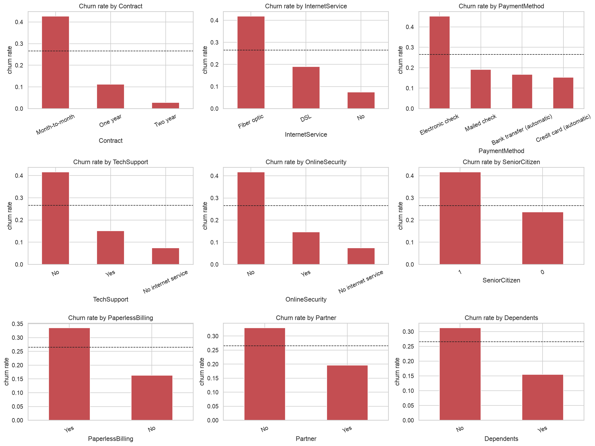
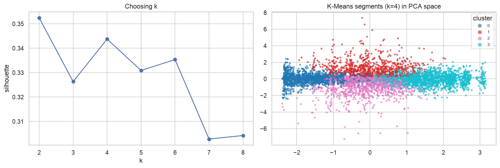
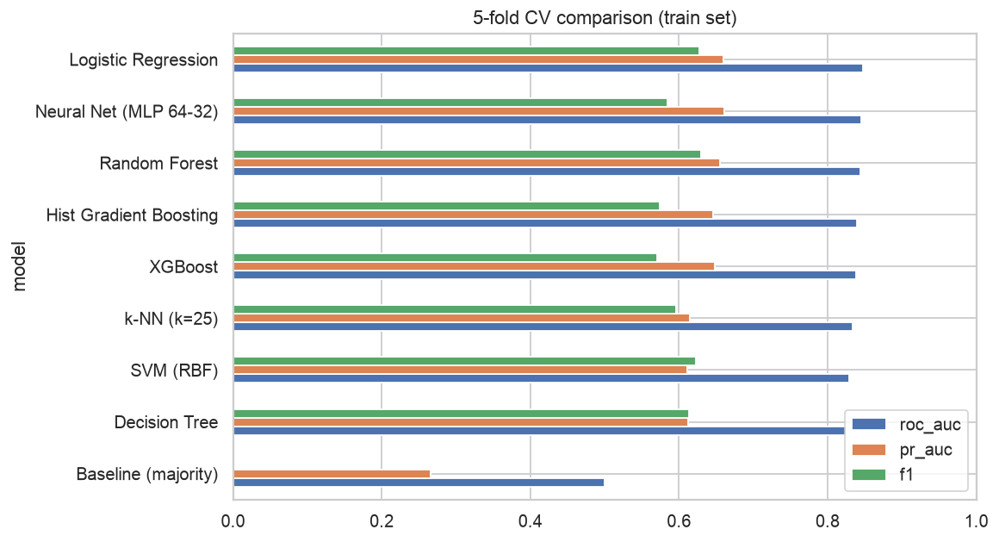
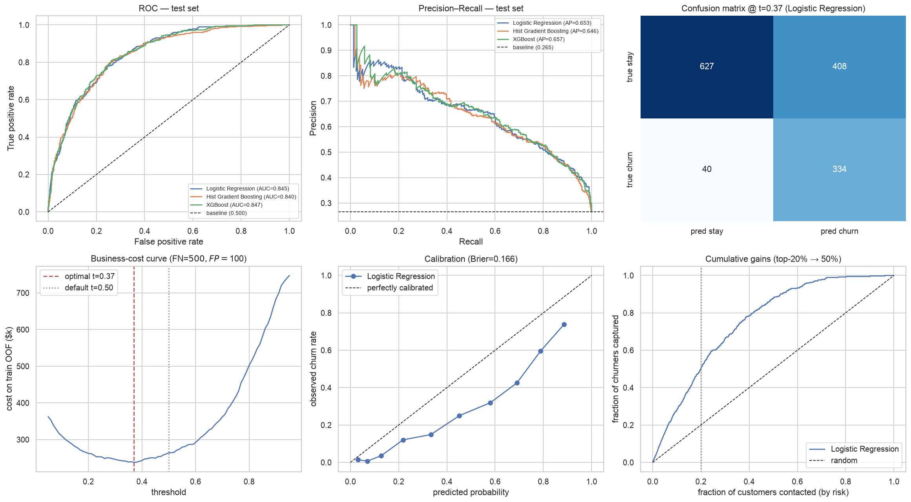

# I Asked an AI Agent to Be My Data-Science Professor: Predicting Telco Churn End-to-End with CRISP-DM

*CMPE 255 · Sai Swaroop Dindi · Code: <YOUR_GITHUB_REPO_URL> · Video: <YOUR_YOUTUBE_URL>*

## Why churn?
Roughly **27%** of the 7,043 customers in the IBM Telco dataset left. Keeping a customer is
much cheaper than winning a new one, so the question is simple: *who is about to leave, and is it worth calling them?*

## The workflow: CRISP-DM, one chunk at a time
I gave an agentic coding assistant (Claude in Cowork) the same "expert CRISP-DM professor" persona and chunked prompt from
class, and asked it to build a reproducible notebook instead of a one-off chat. Each phase below maps to a section of the notebook.

### 1 · Business understanding
We framed churn as a cost problem: missing a churner costs ≈ $500, a wasted retention offer ≈ $100.
That single assumption ends up deciding the model's threshold.

### 2 · Data understanding
Only one real data-quality issue: `TotalCharges` was text because 11 brand-new customers had a blank value.
The strongest categorical signals (Cramér's V) were Contract, OnlineSecurity, TechSupport, InternetService; among numeric features,
`tenure` separated churners best (rank-biserial r = 0.48).
Month-to-month contracts churn at 43% vs 3% for two-year contracts.

### 3 · Data preparation
Blank charges → 0 (nothing billed yet); engineered `num_services`, `avg_monthly_spend`, `charge_delta`, `auto_pay`, tenure buckets.
The test set was split off **before** any fitting, and all encoding lives inside a scikit-learn Pipeline, so there's no leakage.
Isolation Forest flagged 3% of rows as unusual, but they churned at 14%. They were real customers, so we kept them.
K-Means found 4 segments with very different churn rates, which gives marketing a natural targeting map.

### 4 · Modeling
9 models (majority baseline, logistic regression, decision tree, random forest, histogram gradient boosting,
SVM, k-NN, an MLP neural net, XGBoost) went through 5-fold stratified CV, then the best families were tuned with randomized search.
The winner was **Logistic Regression**. Logistic regression itself won, a reminder that simple, well-regularised models are hard to beat on tabular churn data.

### 5 · Evaluation (the part most tutorials skip)
* Test ROC-AUC **0.845**, PR-AUC **0.653** (baseline PR-AUC = 0.265).
* The default 0.5 threshold catches 80% of churners. The **cost-optimal threshold 0.37**, picked on training folds only, catches **89%**.
* That cuts the business cost from $187,000 (do nothing) to $60,800, a **67% saving**.
* Calling the riskiest 20 % of customers reaches 50% of all churners.

The top drivers by permutation importance were `tenure`, `Contract`, `tenure_bucket`, `InternetService`. That matches the EDA, which is a good sign the model learned real structure and not noise.

### 6 · Deployment
The full pipeline is saved with joblib and served through a small Streamlit "what-if" app with a model card and monitoring plan.

## What I learned about AI-assisted data science
1. **Prompt for process, not answers.** The CRISP-DM persona and chunking produced a far more principled workflow than "build a churn model".
2. **Verify leakage yourself.** I checked that thresholds and encoders were fit on training data only.
3. **Accuracy lies on imbalanced data.** The do-nothing baseline scores 73% accuracy and is useless.

*Full code, figures, prompts and transcript: <YOUR_GITHUB_REPO_URL>*
